# Bairro em Dia

**CitizenTech — um bairro melhor começa com você.**

Repositório: https://github.com/Gabriel-Dias-Santiago/dp2_551406_gabrieldias

MVP Flutter para registrar problemas em espaços públicos, organizar as prioridades por bairro e acompanhar melhorias. Desenvolvido para a **Prova DP FIAP 2026.2**, 3º ano de Sistemas de Informação, disciplina Desenvolvimento Cross-Platform com Flutter. Prazo de entrega: **19/11/2026**. A prova específica vale até 10 pontos e representa 80% da GS.

**[Ver todos os prints do aplicativo](docs/SCREENSHOTS.md)** · [Verificação e pendências da entrega](docs/VALIDACAO.md)

## Integrante

| Nome completo | RM |
| --- | --- |
| Gabriel Dias Santiago | 551406 |

## Problema, público e proposta

Bueiros obstruídos, resíduos nas calçadas, iluminação defeituosa e caminhos inacessíveis prejudicam a mobilidade, a saúde e o cuidado com os espaços públicos. As demandas se perdem quando ficam apenas em conversas e anotações dispersas.

O Bairro em Dia atende moradores, lideranças comunitárias e agentes que precisam organizar uma observação do território. O cidadão descreve o problema, informa bairro e local, classifica prioridade e risco e acompanha a situação até a resolução. A tela de bairros permite concentrar atenção nas regiões com mais demandas prioritárias.

O MVP mantém **registros locais neste dispositivo**. Não transmite solicitações à prefeitura, não representa um protocolo oficial e não sincroniza dados entre pessoas. Os quatro registros iniciais são **exemplos fictícios**, identificados na interface; podem ser editados e excluídos. Novos registros são identificados como dados do usuário.

### Conexão com os ODS da ONU

A contribuição proposta é organizar informações que apoiem ações da comunidade; o aplicativo não mede redução efetiva de doenças, alagamentos ou emissões.

| Objetivo | Relação com o MVP |
| --- | --- |
| [ODS 3 — Saúde e bem-estar](https://brasil.un.org/pt-br/sdgs/3) | Registrar água parada e resíduos ajuda a identificar ambientes que precisam de cuidado, em conexão com as metas 3.3 e 3.9. |
| [ODS 11 — Cidades e comunidades sustentáveis](https://brasil.un.org/pt-br/sdgs/11) | Acompanhar resíduos, iluminação, calçadas e rampas apoia a organização de demandas por espaços públicos acessíveis, em conexão com as metas 11.6 e 11.7. |
| [ODS 13 — Ação contra a mudança global do clima](https://brasil.un.org/pt-br/sdgs/13) | Identificar bueiros obstruídos e locais de acúmulo de água apoia a preparação comunitária para chuvas, em conexão com a meta 13.1. |

## Telas e funcionalidades

| Tela | O que permite fazer |
| --- | --- |
| **1. Home / Dashboard** | Visualizar totais, pendentes, resolvidos, atenção prioritária, registros recentes e ODS. Abrir cadastro, lista e bairros. |
| **2. Registros** | Consultar cards com `ListView.separated`, buscar por título/bairro/local/categoria e filtrar por situação. Exibe carregamento, vazio, nenhum resultado e erro com nova tentativa. Arrastar para atualizar. |
| **3. Cadastro / edição** | Preencher título, categoria, bairro, referência, descrição, prioridade, situação e risco. Validação obrigatória e feedback ao salvar. Edição previamente preenchida. |
| **4. Detalhes** | Ver todos os campos, identificador, criação e atualização. Editar ou excluir mediante confirmação; cancelar preserva o registro. |
| **5. Prioridades por bairro** | Consultar proporção de resolvidos e ranking por região, filtrar bairros com atenção e abrir a lista do bairro escolhido. |

O ranking considera primeiro a quantidade de registros **pendentes com risco ou prioridade alta**, depois o total de pendentes e, em empate, o nome do bairro. Registros resolvidos deixam de contar como pendentes e como atenção prioritária. Bairros com diferenças apenas de maiúsculas e espaços nas bordas são agrupados.

### Fluxo sugerido para avaliação

1. Na Home, observe os quatro exemplos e os indicadores: 4 registros, 3 pendentes e 1 resolvido.
2. Abra **Registrar um problema** e tente salvar sem preencher: o formulário apresenta os erros e bloqueia a gravação.
3. Preencha os campos e salve. A Home e a lista passam a refletir o novo registro.
4. Abra **Registros**, busque o registro e consulte seus detalhes.
5. Toque em **Editar registro**, altere a situação para **Resolvido** e salve.
6. Abra **Bairros** e observe o resumo e os filtros; toque em um bairro para consultar seus registros.
7. Nos detalhes, tente excluir e cancele. Repita confirmando a exclusão.
8. Reinicie o app para conferir que as mudanças foram persistidas.

## Executar — Zero-Config

### Pré-requisitos

- **Flutter 3.50.0 ou superior**, com Dart 3.14 ou superior, no canal stable. Essa é a versão do projeto inicial e a versão efetivamente verificada.
- Ambiente Flutter da plataforma escolhida: dispositivo/emulador Android ou simulador iOS (macOS), ou Linux/Chrome para execução alternativa. O SDK Android, Xcode ou toolchain desktop são parte do ambiente Flutter da plataforma.
- Internet para obter o SDK e baixar dependências públicas na primeira instalação. Depois de compilado, o CRUD local não exige conexão, contas, chaves ou backend.

### Clonar, instalar e executar

```bash
git clone https://github.com/Gabriel-Dias-Santiago/dp2_551406_gabrieldias.git
cd dp2_551406_gabrieldias
flutter pub get
flutter run
```

Se houver mais de um dispositivo, escolha o destino na lista apresentada pelo Flutter. Também é possível selecioná-lo explicitamente:

```bash
flutter devices
flutter run -d <ID_DO_DISPOSITIVO>
```

**Verificação realizada:** em uma cópia limpa, sem banco ou arquivos gerados, `flutter pub get` seguido de `flutter run -d linux --release` compilou, iniciou o app e criou automaticamente os quatro exemplos.

Não é necessário criar tabelas, executar migrações, configurar `.env`, iniciar servidor de API, criar contas ou carregar dados manualmente. O SQLite é criado pelo app na primeira operação de leitura. O `pubspec.lock` deve permanecer versionado.

Para a alternativa web, os arquivos `web/sqlite3.wasm` e `web/sqflite_sw.js` **já estão incluídos**; não execute geração ou setup adicional. O navegador mantém o SQLite no armazenamento local da origem. Limpar dados do site ou trocar a origem cria um banco independente. No mobile, desinstalar o app remove seus dados locais.

### Testes e análise

```bash
flutter analyze
flutter test
```

São **42 testes: 35 das camadas de domínio/dados/estado, 1 de integração Provider/SQLite e 6 de interface**, todos executados com sucesso. Os testes de persistência usam SQLite real em arquivos temporários independentes do banco do aplicativo.

| Área | Quantidade | Cobertura |
| --- | ---: | --- |
| Domínio / modelos | 10 | Serialização, validações, risco, resolução, agrupamento e ranking. |
| Repositório SQLite e integração com Provider | 13 | Criação automática, CRUD, reabertura, seed único, concorrência, ordenação, inválidos, IDs inexistentes e texto com SQL. |
| Provider | 13 | Loading, notificações, falhas, recuperação, CRUD reativo, indicadores, imutabilidade e bloqueio de operações concorrentes. |
| Interface | 6 | Fluxo CRUD, confirmação/cancelamento, edição preenchida, validação, busca, filtros, quinta tela, erro, recuperação e tela estreita com texto ampliado. |

Resultados reais, comandos de build, limites do ambiente e reprodução da verificação no Chrome: [docs/VALIDACAO.md](docs/VALIDACAO.md).

## Arquitetura e decisão de persistência

Foi escolhida **exatamente a Opção B — SQLite local assíncrono**. O repositório inicial não tinha tema nem persistência. Essa opção permite o funcionamento básico sem serviços externos ou credenciais. Os adaptadores de plataforma usam o mesmo banco SQLite e o mesmo repositório; não há uma segunda fonte de dados ou API REST.

```text
lib/
  main.dart                  # Inicialização Flutter
  app.dart                   # MaterialApp, tema e MultiProvider
  domain/                    # Modelos, validações e resumos por bairro
  data/                      # Contrato, SQLite, conexão por plataforma e seed
  state/                     # IssuesProvider / ChangeNotifier
  ui/
    app_theme.dart           # ThemeData e cores
    screens/                 # Home, lista, formulário, detalhes e bairros
    widgets/                 # Cards, estados, navegação, notas e ilustração
```

- **Estado:** `IssuesProvider` centraliza os registros, carregamento, gravação, erros e indicadores. `MultiProvider`, `ChangeNotifierProvider`, `Consumer`, `context.watch` e `context.read` conectam a interface. `setState` é usado apenas para filtros e controles temporários do formulário.
- **Navegação:** `Navigator.push`, `pop`, `pushReplacement` e `popUntil`; detalhes e edição recebem `issueId`, e a lista recebe o bairro como argumento. Os detalhes consultam o Provider a cada atualização para evitar dados desatualizados.
- **Persistência:** `IssueRepository` define operações `Future`; `SqliteIssueRepository` implementa todas com `async`/`await`. Android/iOS/macOS usam `sqflite`; Linux/Windows usam `sqflite_common_ffi`; web usa `sqflite_common_ffi_web` com SQLite/WASM e worker locais.
- **Consistência:** a interface só incorpora uma gravação após a confirmação do banco. Falhas preservam os registros e mostram mensagens. O Provider impede gravações duplicadas e recarga concorrente com gravações. Aberturas concorrentes compartilham uma conexão; uma falha de abertura permite repetir a tentativa.
- **Validação:** `Form`, `GlobalKey<FormState>`, `TextFormField`, `validator`, `DropdownButtonFormField` e `SwitchListTile`. As regras também são aplicadas na camada de dados e protegidas por restrições SQL.
- **Apresentação:** Material 3 com o pacote oficial `material_ui`, usado pelo Flutter 3.50 do projeto. Componentes reutilizáveis, rótulos, tooltips, SafeArea, rolagem e cores com indicação textual de situação. Fontes e ilustração são locais.

### Estrutura do SQLite

Arquivo **`bairro_em_dia.db`**, schema versão **1**, tabela **`issues`** criada automaticamente por `onCreate`.

| Coluna | Tipo / regra |
| --- | --- |
| `id` | INTEGER PRIMARY KEY AUTOINCREMENT |
| `title` | TEXT NOT NULL, 5–80 caracteres sem espaços nas bordas |
| `description` | TEXT NOT NULL, 15–1000 caracteres |
| `neighborhood` | TEXT NOT NULL, 2–60 caracteres |
| `address` | TEXT NOT NULL, 5–160 caracteres |
| `category` | TEXT: `waste`, `drainage`, `lighting`, `accessibility` |
| `priority` | TEXT: `low`, `medium`, `high` |
| `status` | TEXT: `open`, `inProgress`, `resolved` |
| `has_risk` | INTEGER, 0 ou 1 |
| `created_at` | TEXT, data ISO 8601 em UTC |
| `updated_at` | TEXT, data ISO 8601 em UTC |
| `is_demo` | INTEGER, 0 ou 1; identifica exemplos fictícios |

O caminho é obtido pelo `DatabaseFactory` da plataforma. Em execução Linux de desenvolvimento, o adaptador usa `.dart_tool/sqflite_common_ffi/databases/`. No mobile, usa o diretório de bancos do aplicativo. As datas são armazenadas em UTC e exibidas no horário local. A carga inicial só ocorre em `onCreate`; excluir todos os exemplos e reiniciar não os recria. A atualização preserva o ID, a data de criação e a identificação de exemplo. As consultas usam argumentos vinculados, sem concatenar entradas do usuário no SQL.

## Galeria — aplicativo real em execução

Capturas feitas no Chrome com o app Flutter em execução e SQLite real, sem imagens simuladas. A viewport tem 390 px de largura; formulário, validação e detalhes usam altura maior para mostrar o conteúdo. Os dados iniciais são fictícios e identificados como exemplos.

**[Abrir galeria completa e conferir os prints obrigatórios](docs/SCREENSHOTS.md).** São 10 capturas em formato de celular e 3 capturas desktop complementares, com imagens de todas as telas exigidas, incluindo validação do formulário.

| Home | ODS na Home | Listagem |
| --- | --- | --- |
|  | 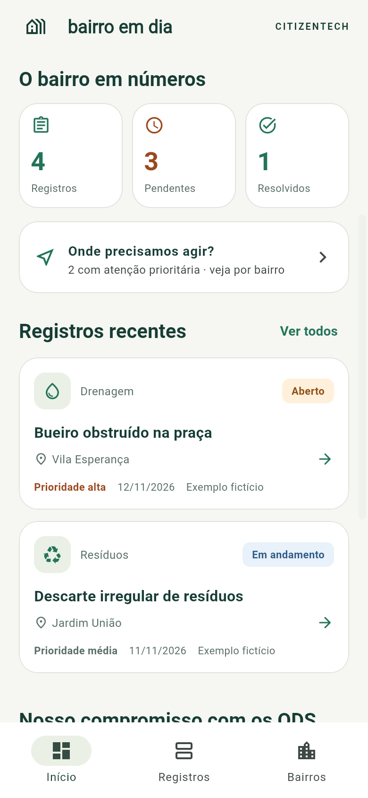 | 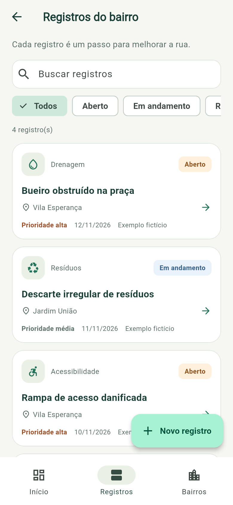 |

| Formulário | Validação obrigatória | Detalhes |
| --- | --- | --- |
| 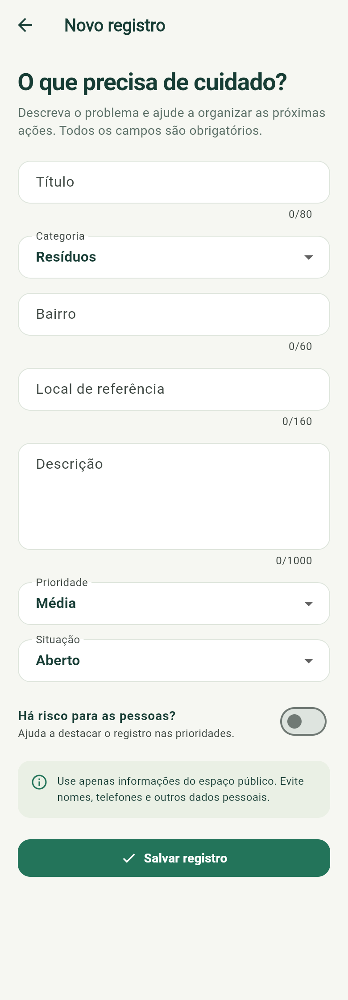 | 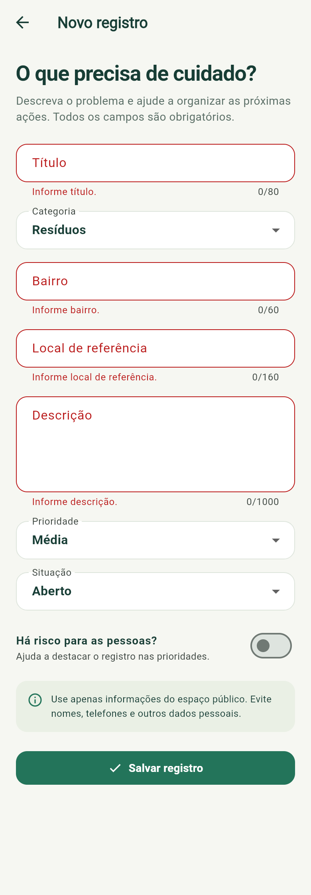 | 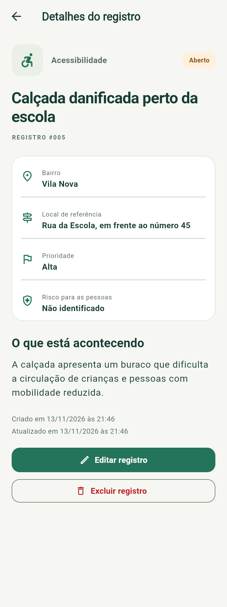 |

| Edição preenchida | Confirmação de exclusão | Quinta tela funcional |
| --- | --- | --- |
| 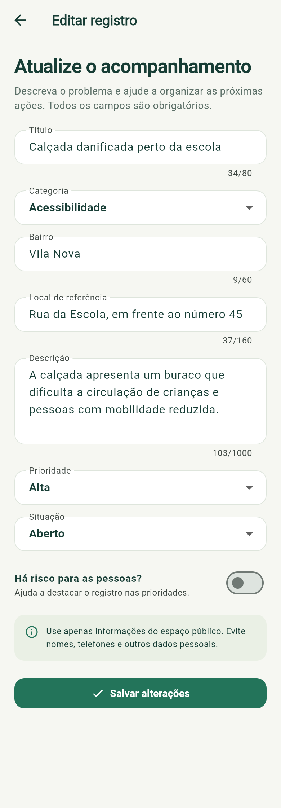 | 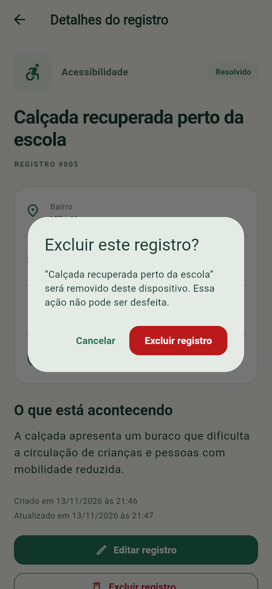 | 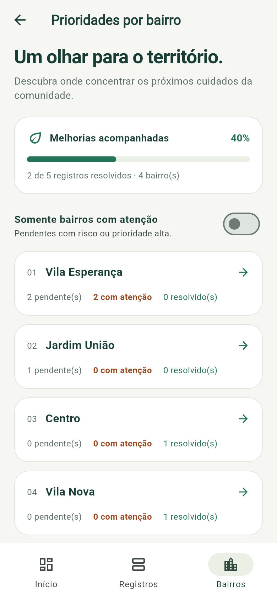 |

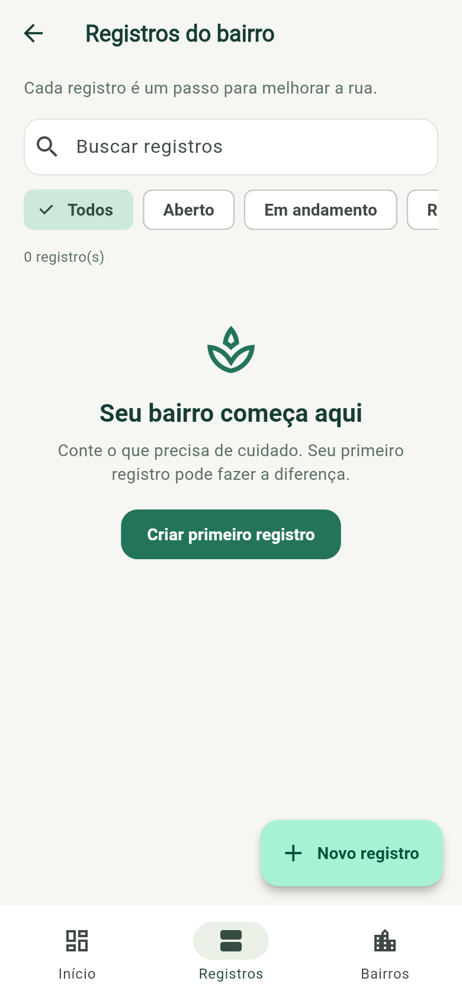

### Prints desktop complementares

Capturas reais em viewport de 1440 × 1000 px, com os quatro exemplos iniciais:

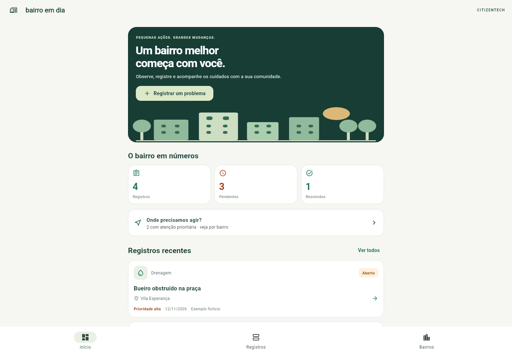

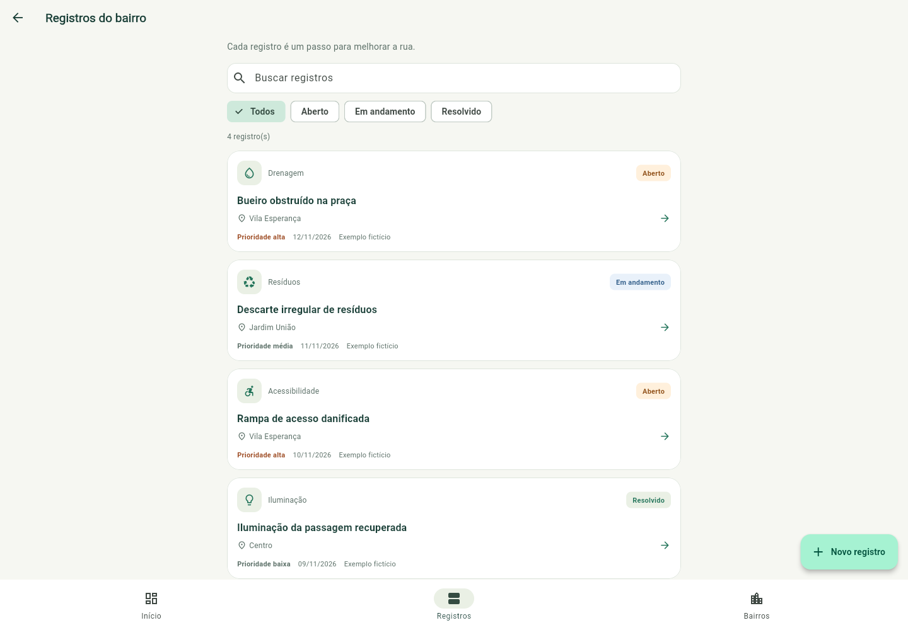

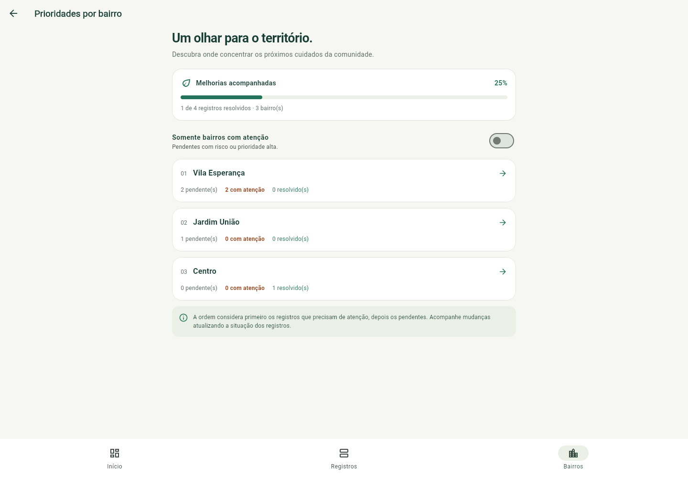

## Entrega

Conforme o item 4.2 do enunciado, o Portal do Aluno FIAP recebe um arquivo com o link do repositório. O código-fonte, o README e os prints permanecem no GitHub.

Arquivo para anexar: [Entrega_FIAP_DP2026_2_RM551406.pdf](entrega/Entrega_FIAP_DP2026_2_RM551406.pdf).

Prazo: **19/11/2026**, na área de trabalhos da disciplina Desenvolvimento Cross-Platform com Flutter. O arquivo de texto [link_repositorio.txt](entrega/link_repositorio.txt) contém os mesmos dados de identificação e o link.

## Validação

A suíte de 42 testes, a análise estática e os builds web e Linux foram concluídos com sucesso. A execução também foi conferida em uma cópia limpa, sem banco ou arquivos de build. O roteiro no Chrome verificou o CRUD e a persistência após recarregar a página.

A execução em dispositivo ou emulador Android/iOS ainda não foi verificada. Os resultados e o ambiente de teste estão em [docs/VALIDACAO.md](docs/VALIDACAO.md).

## Referências e recursos locais

- [Provider](https://pub.dev/packages/provider), [sqflite](https://pub.dev/packages/sqflite), [SQLite FFI web](https://pub.dev/packages/sqflite_common_ffi_web).
- A família Roboto foi incluída com sua licença em [assets/fonts/Roboto_LICENSE.txt](assets/fonts/Roboto_LICENSE.txt). A ilustração da Home é desenhada pelo próprio app.
- `web/sqflite_sw.js` e `web/sqlite3.wasm` foram gerados pelo setup oficial da versão 1.2.2 do adaptador web e são distribuídos com o projeto para dispensar configuração adicional.
