# Prints do aplicativo — Bairro em Dia

Capturas reais do aplicativo Flutter em execução no Chrome, com SQLite local. As imagens em formato de celular usam uma viewport de 390 px de largura; as capturas desktop complementares usam 1440 × 1000 px. As imagens não representam um emulador Android ou iPhone.

## Cobertura dos prints obrigatórios

| Exigência da prova | Print |
| --- | --- |
| Home / Dashboard | [Home](screenshots/01-home.png) e [ODS e registros recentes](screenshots/02-home-ods.png) |
| Listagem com ListView | [Listagem](screenshots/03-listagem.png) |
| Formulário | [Cadastro](screenshots/04-formulario.png) |
| Formulário demonstrando validação | [Campos obrigatórios inválidos](screenshots/05-validacao.png) |
| Detalhes do registro | [Detalhes](screenshots/06-detalhes.png) |
| Quinta tela funcional | [Prioridades por bairro](screenshots/09-bairros.png) |

Todos os prints obrigatórios estão incluídos. Há também evidências de edição preenchida, confirmação de exclusão e lista vazia.

## Home / Dashboard

## ODS e registros recentes na Home

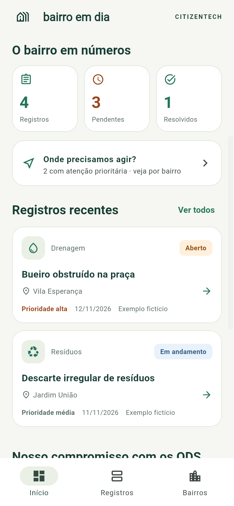

## Listagem dinâmica

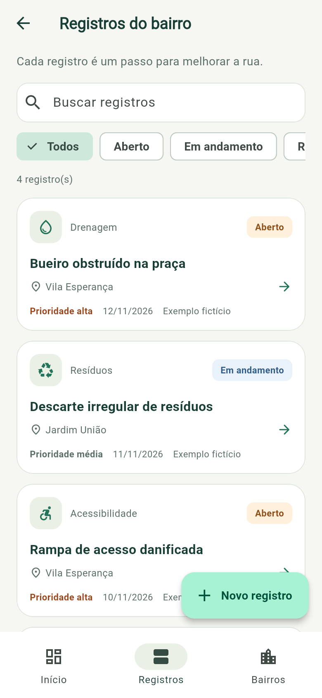

## Formulário de cadastro

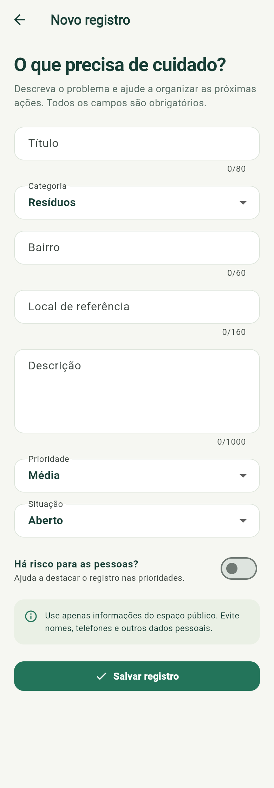

## Validação do formulário

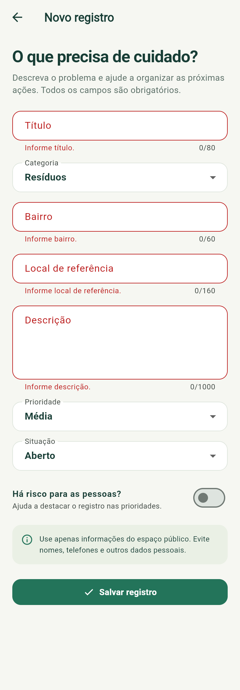

## Detalhes do registro

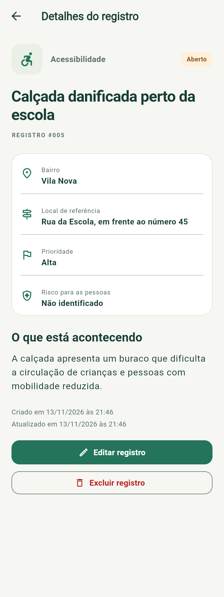

## Edição com dados preenchidos

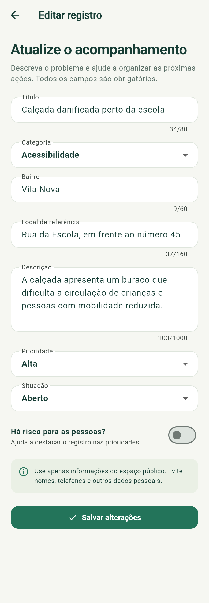

## Confirmação de exclusão

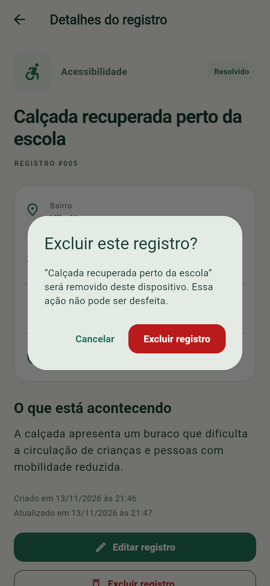

## Quinta tela — prioridades por bairro

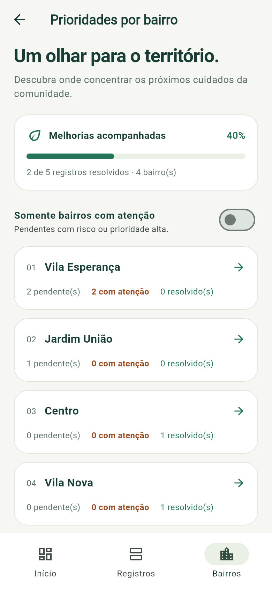

## Lista vazia

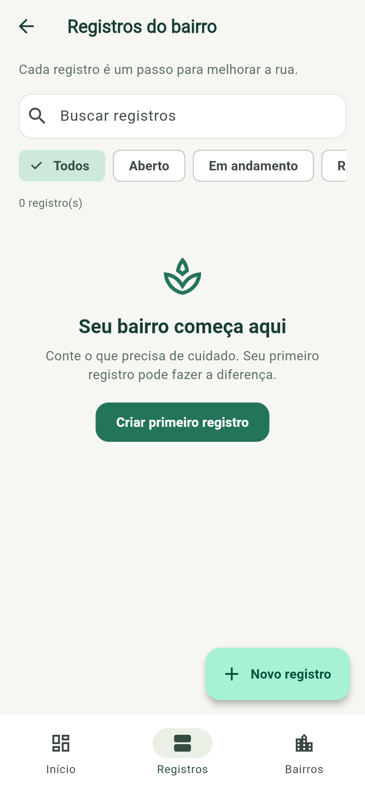

## Capturas desktop complementares

Capturas adicionais realizadas em 13/11/2026, usando os quatro exemplos iniciais em um contexto descartável do navegador.

### Dashboard no desktop

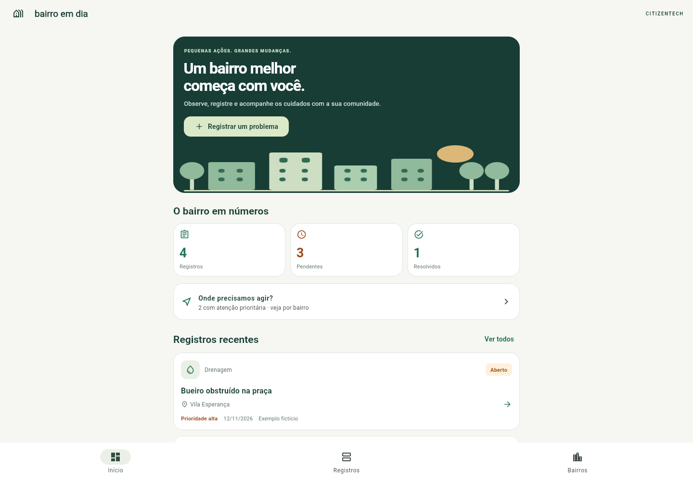

### Listagem no desktop

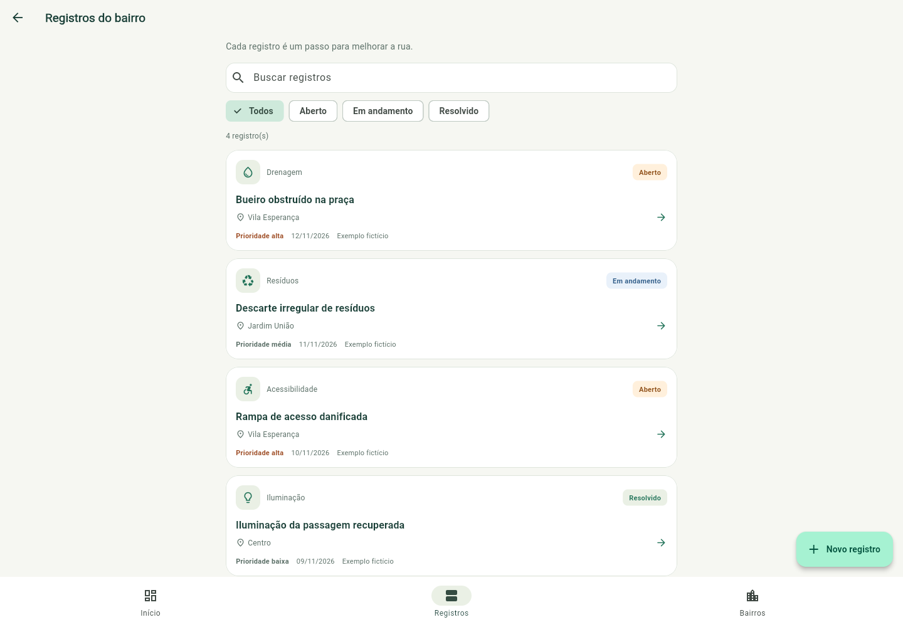

### Prioridades por bairro no desktop

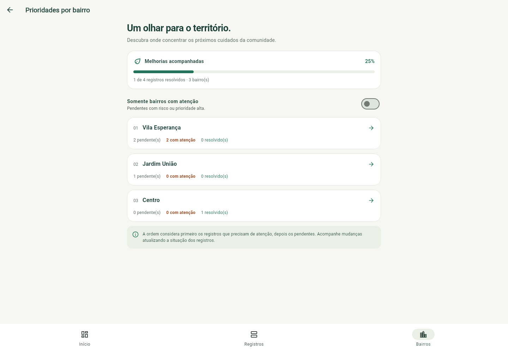

[Voltar ao README](../README.md) · [Verificação e pendências da entrega](VALIDACAO.md)
